# Проверка сверки по планограмме · 1 ноября 2026

Проверял, насколько правильно IR считает соответствие полки планограмме: процент и статусы
каждого места. Для этого по реальному фото полки собирал похожую планограмму, затем менял её
известным образом и сверял фото. Ожидаемый результат в таких тестах известен заранее, поэтому
видно, где сверка права, а где нет.

## Как проверял

- **Фото.** Исходники из `data/datasets/golden_data_from_salesbox` — те же 33 фото, что в
  `outputs/prod_v0_check`, но без нарисованных рамок.
- **Распознавание.** IR из ветки `islambek/planogram-studio` (`a18829e`): боевой детектор
  `yolo11s-salesbox-v0-clean`, галерея эталонов из Qdrant.
- **Планограмма.** В Planogram Studio кнопкой «Черновик по фото»: ряды и пачки главного стеллажа
  с фото ставятся на шкаф. Неузнанные пачки остаются пустыми местами.
- **Сверка.** «Сверка IR → Фото → IR»: фото уходит в IR вместе с планограммой, в ответ приходит
  отчёт по каждому месту на полке.
- **Процент соответствия** = мест «на месте» / мест в планограмме. Пачки сверх плана в процент не
  входят.

## Фото

| | | | | |
|---|---|---|---|---|
| 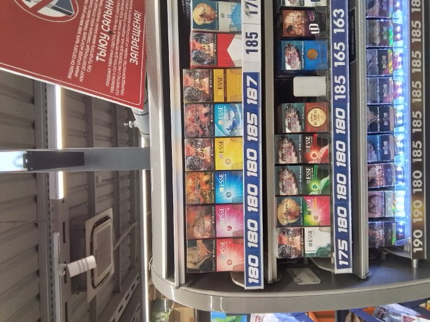 | 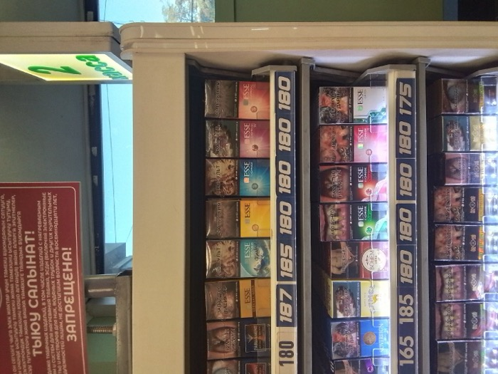 | 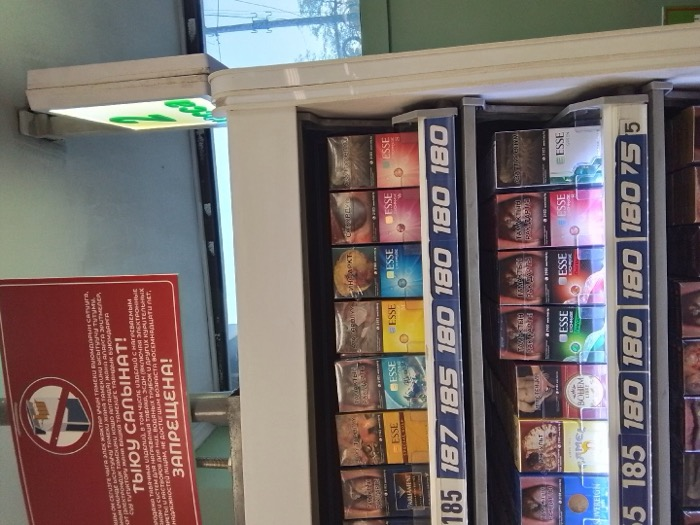 | 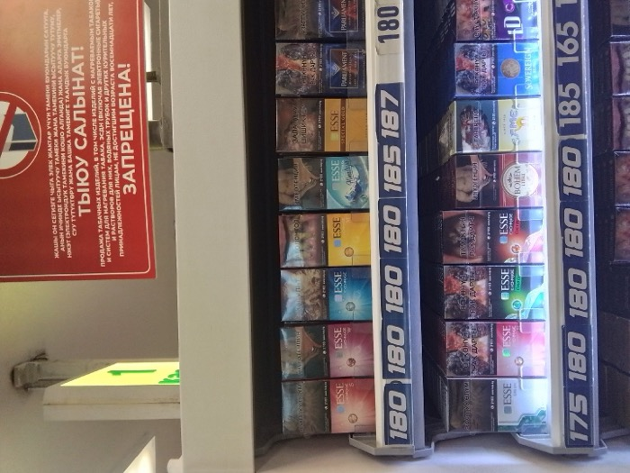 | 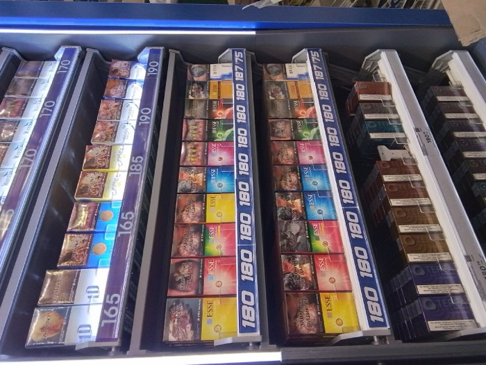 |
| **0051** — 3 ряда, 25 пачек, 84 % узнано до модели | **0424** — 2 ряда, 16 пачек | **0069** — та же полка, что 0424, другой снимок | **0423** — та же полка, левый участок | **0047** — 4 ряда, 38 пачек, узнано 37 % |

## Результаты

| # | Планограмма по фото | Фото проверки | Что изменено | Ожидалось | Соответствие | На месте | Не на месте | Не та полка | Нет на полке | На проверку | Сверх плана |
|---|---|---|---|---|---|---|---|---|---|---|---|
| 1 | 0051 | 0051 | ничего, точная копия | 100 % | **100 %** | 21 | 0 | 0 | 0 | 0 | 4 |
| 2 | 0051 | 0051 | переставлены Esse Exchange S и M на верхней полке | 19/21 = 90,5 % | **90,48 %** | 19 | 2 | 0 | 0 | 0 | 4 |
| 3 | 0051 | 0051 | убран Marlboro Red; добавлен обязательный Parliament Aqua Blue ×2, которого нет на полке | 20/22 = 90,9 % | до исправления **86,36 %** | 19 | 1 | 0 | 1 | 1 | 4 |
| 3 | 0051 | 0051 | то же, после исправления | 20/22 = 90,9 % | **90,91 %** | 20 | 0 | 0 | 1 | 1 | 4 |
| 4a | 0424 | 0424 | ничего | 100 % | **100 %** | 13 | 0 | 0 | 0 | 0 | 3 |
| 4b | 0424 | 0069 | та же полка, другой снимок | высокое | **100 %** | 13 | 0 | 0 | 0 | 0 | 2 |
| 4c | 0424 | 0423 | та же полка, в кадре левый участок | низкое | **23,08 %** | 3 | 6 | 2 | 0 | 2 | 3 |
| 5 | 0051 | 0069 | планограмма другого магазина | низкое | **23,08 %** | 3 | 7 | 1 | 0 | 2 | 2 |
| 6 | 0047 | 0047 | плохо распознанное фото | — | **100 %** | 14 | 0 | 0 | 0 | 0 | 24 |

В тесте 3 наличие обязательных SKU (OSA) показало Parliament Aqua Blue KS: **нет на полке**.

## Выводы

1. **Подсчёт верный.** На управляемых правках процент и статусы совпали с ожидаемыми до
   конкретного места: в тесте 2 «не на месте» помечены ровно две переставленные пачки.
2. **Нашлась и исправлена ошибка выравнивания (тест 3).** В среднем ряду на фото есть пустое
   место и лишняя пачка, а ожидаемая LD Impulse стоит на одно место правее. При стоимости
   `mismatch = 1.0` неверный вариант выравнивания был дешевле верного: LD «пропадала» в пустоту,
   а сама LD считалась чужой пачкой на месте Parliament. Теперь `mismatch = 1.5`: чужая пачка на
   месте дороже, чем «пустота пропущена и ожидаемой нет» (0,8 + 1,0 − 0,5). Исправлено в IR
   (`packages/shelf`, коммит `a18829e`, с регрессионным тестом) и в Studio (PR #3). Тесты 1 и 2
   после правки не изменились.
3. **Повторный визит той же полки считается правильно (тест 4b):** 100 % на другом снимке.
4. **Чужая полка честно даёт низкий процент (тест 5):** 23 %, совпали только Esse.

## Доработка после проверки: черновик по фото похож на полку

На скриншотах ниже первый вариант черновика по фото 0051 совсем не похож на полку:
- **Шкаф не по фото.** Пачки стояли на шаблоне 96×170 см, три полки растянулись на всю высоту.
- **Часть пачек не нарисована.** Esse Green, Summer Red, Cold Green и Cold Black распознаются,
  но их меток не было в каталоге Studio, и сцена такие пачки молча пропускала.

Что исправлено (Studio, PR #6):
- **Шкаф собирается по фото.** Ширина считается по самому длинному ряду, включая неузнанные
  пачки, высота полки — по пачкам ряда. Для 0051 получилось 59×57 см.
- **Лицевые стороны пачек** — вырезки из самого снимка.
- **Новые метки IR** сами добавляются в каталог, пачки вне каталога рисуются по метке.
- **В редакторе** можно менять размер шкафа, есть кнопка «Ужать шкаф по пачкам».
- **Новые типовые шкафы:** прилавочный диспенсер, компактная навесная полка, узкий кассовый,
  над кассой, широкий на 9 полок.

**Было:** черновик по 0051 на шаблоне 96×170 см.

**Стало:** черновик по 0051, шкаф по фото и пачки с фото. Сверка тем же фото — 100 %.
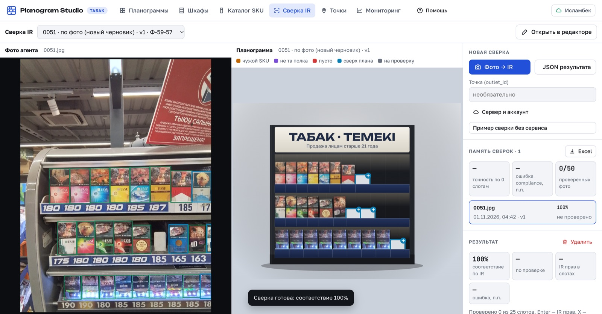

**Старая планограмма после «Ужать шкаф по пачкам»:** 53×67 см вместо 96×170.
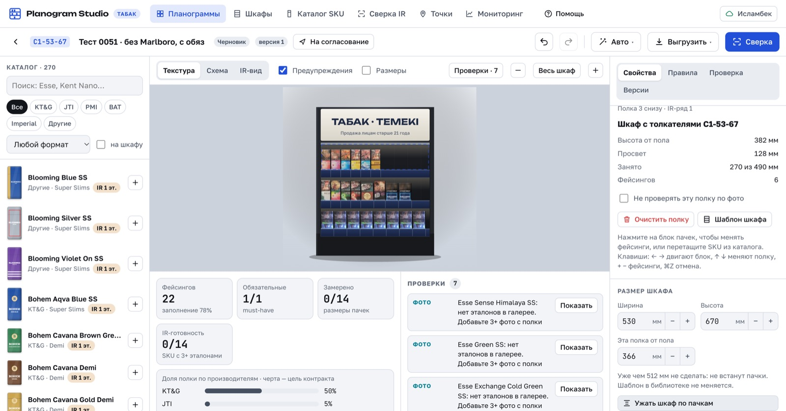

## Ограничения и что дальше

- **Не вся полка в кадре (тест 4c).** Агент снял левый участок, и процент упал до 23 %, хотя
  выкладка та же. IR уже знает, что стеллаж обрезан краем кадра (`cut_left` / `cut_right`).
  Места планограммы за краем можно не засчитывать.
- **Лишние пачки не снижают процент (тест 6).** На 0047 соответствие 100 %, но 24 пачки стоят
  вне плана. Нужна вторая метрика «чистота выкладки» или общий индекс.
- **Всё упирается в распознавание.** На 0047 до модели узнано 37 % пачек, и планограмма по такому
  фото неполная. По всем 33 фото до модели узнан 51 % пачек главного стеллажа (таблица ниже).
  Сверку с человеком в Studio (Enter — IR прав, X — ошибся) стоит использовать, чтобы мерить
  настоящую точность.

## Распознавание по всем 33 фото (главный стеллаж)

| Фото | Рядов | Пачек | Узнано до модели | Только бренд | Не узнано | Доля до модели |
|---|---|---|---|---|---|---|
| 0069 | 2 | 15 | 13 | 0 | 2 | 87 % |
| 0004 | 2 | 14 | 12 | 0 | 2 | 86 % |
| 0451 | 2 | 14 | 12 | 0 | 2 | 86 % |
| 0049 | 2 | 13 | 11 | 0 | 2 | 85 % |
| 0051 | 3 | 25 | 21 | 1 | 3 | 84 % |
| 0035 | 2 | 16 | 13 | 1 | 2 | 81 % |
| 0053 | 2 | 16 | 13 | 1 | 2 | 81 % |
| 0423 | 2 | 16 | 13 | 1 | 2 | 81 % |
| 0424 | 2 | 16 | 13 | 1 | 2 | 81 % |
| 0473 | 2 | 15 | 12 | 1 | 2 | 80 % |
| 0009 | 2 | 14 | 11 | 1 | 2 | 79 % |
| 0056 | 2 | 14 | 11 | 1 | 2 | 79 % |
| 0416 | 2 | 14 | 11 | 2 | 1 | 79 % |
| 0052 | 2 | 16 | 12 | 1 | 3 | 75 % |
| 0055 | 2 | 16 | 12 | 2 | 2 | 75 % |
| 0410 | 2 | 16 | 12 | 2 | 2 | 75 % |
| 0459 | 1 | 16 | 12 | 3 | 1 | 75 % |
| 0483 | 2 | 16 | 12 | 2 | 2 | 75 % |
| 0002 | 2 | 14 | 10 | 2 | 2 | 71 % |
| 0003 | 2 | 16 | 11 | 2 | 3 | 69 % |
| 0071 | 2 | 16 | 11 | 3 | 2 | 69 % |
| 0050 | 3 | 25 | 16 | 1 | 8 | 64 % |
| 0440 | 2 | 30 | 19 | 10 | 1 | 63 % |
| 0438 | 3 | 27 | 13 | 3 | 11 | 48 % |
| 0032 | 6 | 29 | 12 | 14 | 3 | 41 % |
| 0047 | 4 | 38 | 14 | 16 | 8 | 37 % |
| 0475 | 6 | 34 | 8 | 10 | 16 | 24 % |
| 0010 | 7 | 61 | 13 | 1 | 47 | 21 % |
| 0048 | 4 | 40 | 7 | 23 | 10 | 18 % |
| 0352 | 9 | 48 | 6 | 11 | 31 | 12 % |
| 0001 | 6 | 46 | 4 | 0 | 42 | 9 % |
| 0018 | 2 | 18 | 1 | 12 | 5 | 6 % |
| 0482 | 0 | 0 | 0 | 0 | 0 | 0 % |
| **Все 33** | | **724** | **371** | **128** | **225** | **51 %** |

## Автотесты

| Где | Что | Результат |
|---|---|---|
| IR | ruff, формат, границы пакетов | без замечаний |
| IR | mypy `packages` + `service` | чисто: исправлена ошибка типа в `align.py` из `main` (CI mypy не запускает) |
| IR | pytest, включая медленные | 246 прошли, 1 пропущен: нет эталонной разметки детекции |
| Studio | сборка (tsc + vite) | проходит |
| Studio | oxlint | 0 ошибок, 21 предупреждение по стилю React |

## Скриншоты

**Тест 1** — планограмма по 0051, фото 0051: 100 %.

**Тест 2** — две пачки переставлены: 90 %, на фото оранжевым выделены ровно они.
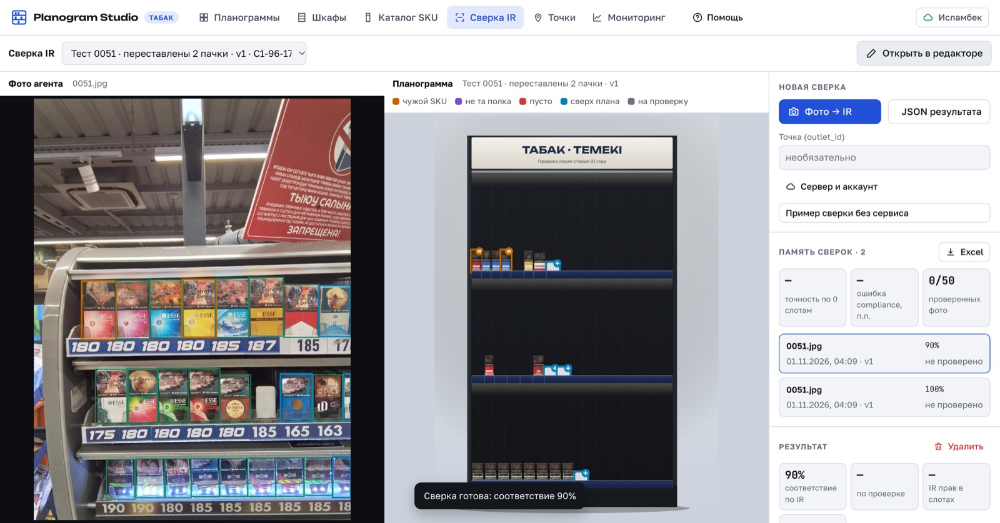

**Тест 3 до исправления** — 86 %: LD Impulse ошибочно «нет на полке» и «не на месте».
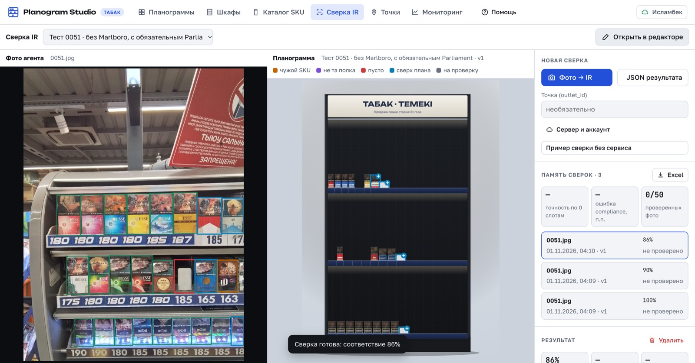

**Тест 3 после исправления** — 91 %, Parliament помечен отсутствующим.

**Тест 4a** — планограмма по 0424, фото 0424: 100 %.
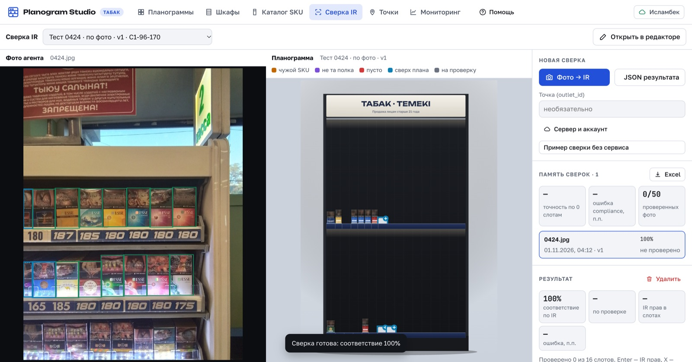

**Тест 4b** — планограмма по 0424, фото 0069 (та же полка, другой снимок): 100 %.

**Тест 4c** — планограмма по 0424, фото 0423 (левый участок той же полки): 23 %.
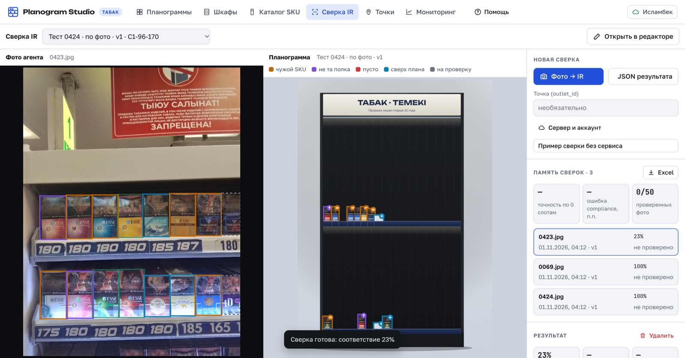

**Тест 5** — планограмма магазина 0051, фото другой полки 0069: 23 %.
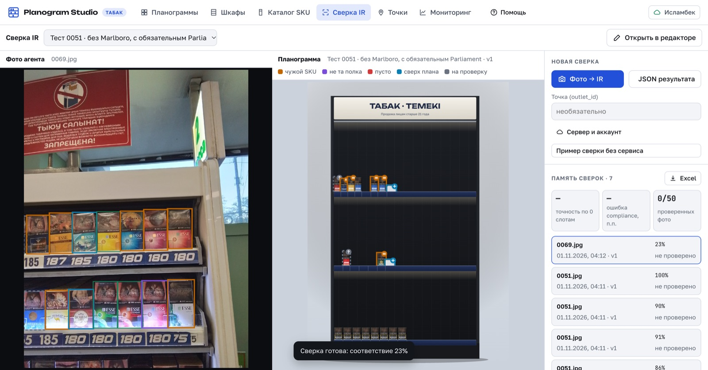

**Тест 6** — плохо распознанное фото 0047: 100 % по 14 пачкам, 24 сверх плана.
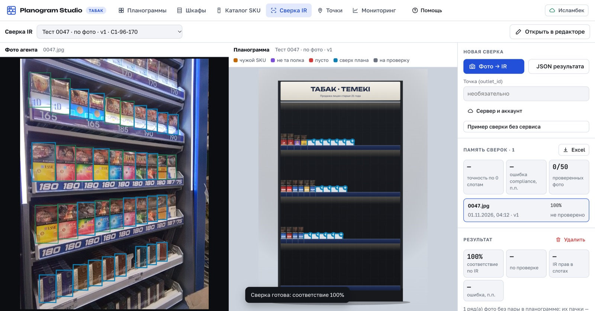

**Планограмма-черновик по фото 0424** в редакторе Studio.
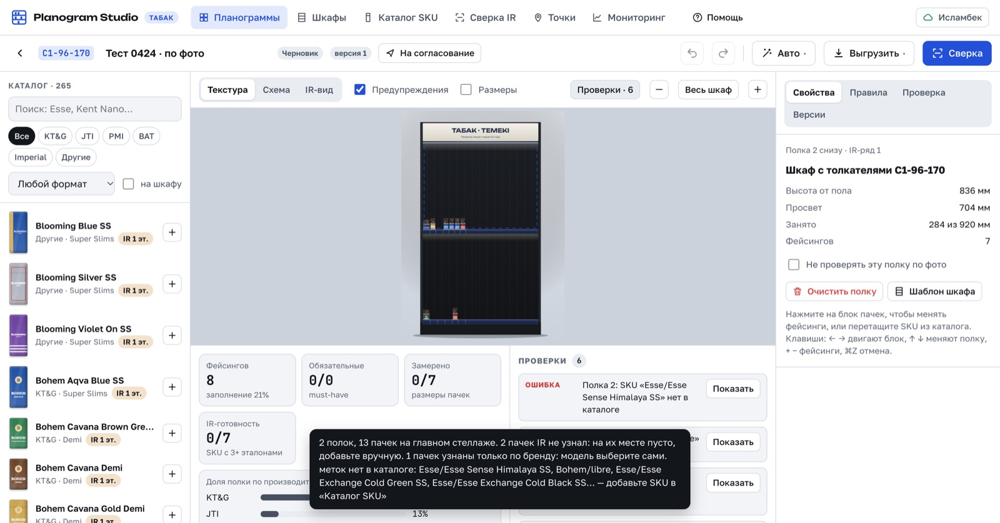
